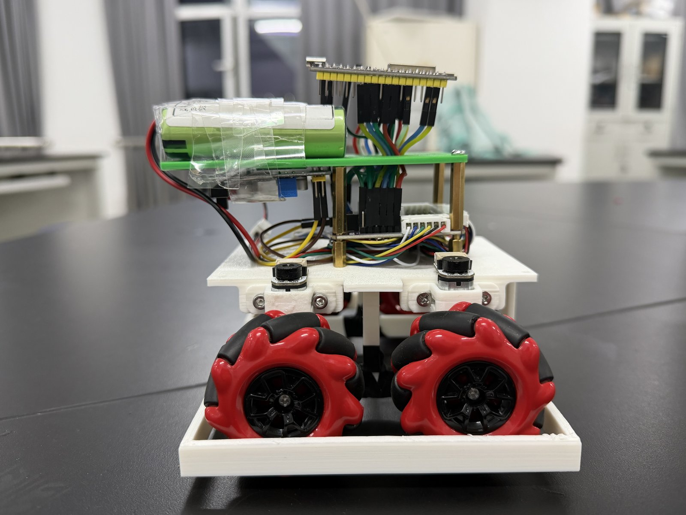

# 比赛清扫机器人

Windows 实机链路为手机俯视取图 → USB/scrcpy → Python/OpenCV/ONNX → 蓝牙 SPP → ESP32 麦轮底盘。场地 1.2 m × 1.2 m，蓝黄各半，红块共 20 个，90 秒内己方剩余红块更少者胜。

双击 [日常工具.cmd](tools/日常工具.cmd) 打开菜单。手机接入、标定、遥控和清扫步骤见 [操作手册](docs/手机接入与自主清扫手册.md)。当前进度和待验收项见 [交接说明](交接说明.md)，开发约定见 [AGENTS.md](AGENTS.md)。

## 入口

- [手机接入与自主清扫手册](docs/手机接入与自主清扫手册.md) 提供现场操作流程与故障处理。
- [常用命令](docs/常用命令.md) 提供终端调用、离线诊断和测试命令。
- [Windows 客户端](windows/README.md) 说明模块、检测器和本机配置。
- [硬件与固件](hardware/README.md) 说明本车接线、固件与调试面板。
- [红块训练](training/README.md) 说明采集、标注、训练和模型评估。
- [文档索引](docs/README.md) 收录设计、汇报和媒体。

## 目录

- `windows/` 包含实机客户端、离线测试、`test_data/` 原图与标注、`models/` ONNX 模型、`tags/` ArUco 图纸。
- `hardware/firmware/` 是本车固件工作副本，`hardware/` 同时保存接线表。
- `tools/` 包含双击入口、面板与 PlatformIO 工具。
- `training/` 包含 YOLO 训练脚本和备用 Colab 笔记本。
- `src/sweep_robot/` 包含共用纯 Python 策略、ROS 2 适配和离线测试。
- `competition_robot/`、`src/sweep_robot_gazebo/` 保存 Gazebo 模型、生成器和插件。h15 仿真保持暂停。
- `docs/PRE_2/`、`docs/PRE_3/`、`docs/PRE_4/` 保存各次汇报，`docs/media/` 保存素材。
- `vendor/` 保存队友原始源码包，`archive/deliverables/` 保存对应 zip，`records/` 保存历史轨迹。

Python 环境、`.deps*`、`tools/*-venv/`、`tools/pio-*`、`hardware/workbench/`、`log/` 和训练产物仅在本机，已由 `.gitignore` 排除。完整 scrcpy 与运行环境位于 `E:\scrcpy\scrcpy-win64-v5.0.1`。

现场标定、整车闭环与完整比赛流程仍待验收。历史日志和离线测试对应各自的开发条件。比赛运行 Windows 客户端，ROS/Gazebo 的恢复由使用方另行安排。
