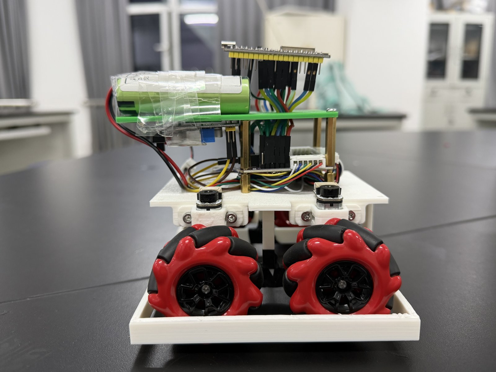

# 比赛清扫机器人

1.2 m × 1.2 m 蓝黄场地，90 秒内把己方（蓝区，y<0）红块推到对面，己方红块少者胜。当前主链路是 **手机俯视取图 → USB/scrcpy → Windows OpenCV/ONNX → 蓝牙 SPP → ESP32 麦轮底盘**；比赛当天不跑 ROS，也不跑 Gazebo。

## 先看这三份

| 文档 | 什么时候看 |
|---|---|
| [交接说明](交接说明.md) | 想知道“现在做到哪、哪些还没验收、下一步做什么” |
| [工作规则](AGENTS.md) | 准备改代码、跑设备或恢复仿真之前 |
| [Windows 说明](windows/README.md) | 操作实机取图、标定、任务、诊断的完整说明 |

## 3 分钟找到入口

- **只想先看看**：双击 [`tools/日常工具.cmd`](tools/日常工具.cmd)，按数字选菜单；菜单默认不连接设备。
- **跑实机自主清扫**：先按 [Windows 说明](windows/README.md) 完成全场标定和底盘参数，再用 [`tools/启动自主清扫.cmd`](tools/启动自主清扫.cmd)。现场标定与整车闭环**尚未验收**。
- **查命令和快捷键**：[docs/常用命令.md](docs/常用命令.md)。
- **手机接入 / 首次配置**：[docs/手机接入与自主清扫手册.md](docs/手机接入与自主清扫手册.md)。
- **训练红块模型**：[training/README.md](training/README.md)。
- **烧固件 / 看接线**：[hardware/README.md](hardware/README.md)、[hardware/firmware/README.md](hardware/firmware/README.md)。
- **跑 ROS 仿真**：先读 [AGENTS.md](AGENTS.md)。h15 仿真目前暂停，未获准不要启动。

## 目录地图

| 路径 | 放什么 | 是否入库 |
|---|---|---|
| `windows/` | Windows 实机客户端：取图、视觉、标定、策略接入、诊断、离线测试 | 是 |
| `windows/test_data/` | 场地照片、红块训练集、标注和清单；先看 [数据索引](windows/test_data/README.md) | 是（约 48 MB） |
| `windows/models/` | 训练好的 `red_block.onnx`，供车上推理 | 是 |
| `windows/tags/` | 车顶 ArUco 图纸（当前 ID 7）和生成脚本 | 是 |
| `src/sweep_robot/` | ROS2 包：纯 Python 策略、仿真适配、节点 | 是 |
| `src/sweep_robot_gazebo/` | Gazebo 防翻车插件 | 是 |
| `competition_robot/` | Gazebo 场地、车体模型和 `build_robot.py` | 是 |
| `training/` | YOLO 训练脚本、Colab 笔记本、本机权重 | 脚本入库；`runs/`、`*.pt`、`*.zip` 本地 |
| `hardware/` | 固件源码、烧录说明、接线表、封存工作台 | 源码入库；`workbench/` 本地 |
| `vendor/` | 队友 2026-11-02 交付的 WHEEL_SPEED_V1 源码包，**只读** | 是 |
| `tools/` | 双击入口、面板、PlatformIO 工具链 | 脚本入库；环境本地 |
| `docs/` | 设计、命令、盘点、历史汇报和媒体；先看 [文档索引](docs/README.md) | 是 |
| `records/` | 实车轨迹 CSV | 是 |
| `archive/` | 队友原始交付 zip（与 `vendor/` 对应） | 是 |
| `log/` | 仿真、视觉、标定的验证证据 | 否，本地保留 |
| `.deps/`、`.deps-gpu/` | 训练/推理用的 Python 依赖（torch、onnxruntime 等） | 否，本地保留 |
| `tools/*-venv/`、`tools/pio-*` | 面板和 PlatformIO 的本地环境 | 否，本地保留 |
| `hardware/workbench/` | 2026-10-22 封存的底盘工作台（约 184 MB） | 否，本地保留 |

## 按任务找文件

| 我想做 | 去哪里 |
|---|---|
| 看车、看红块、拍原图 | `windows/capture_hi.py`、`windows/red_blocks.py`、[Windows 说明](windows/README.md) |
| 标定场地四角、看车体位姿 | `windows/field_view.py`、`windows/pose_tag.py`、`windows/tag_detector.py` |
| 改比赛策略 | `src/sweep_robot/sweep_robot/competition_policy.py`、`row_policy.py`；设计见 [自主策略设计](docs/自主策略设计.md) |
| 改 Windows 任务链路 | `windows/run_task.py`、`windows/nav_servo.py`、`windows/chassis_link.py` |
| 采帧、标注、导出训练集 | `windows/collect_red_frames.py`、`label_boxes.py`、`export_yolo.py` |
| 训练并导出 ONNX | `training/train_local.py`、`windows/训练红块模型.cmd` |
| 比较 HSV 与 ONNX | `windows/evaluate_detector.py`、`windows/比较红块检测.cmd` |
| 烧录固件 | `hardware/firmware/WHEEL_SPEED_V1/motor-bringup/`，步骤见 [tools 说明](tools/README.md) |
| 找历史汇报 | [docs/history/](docs/history/)，第三次汇报在 [`docs/history/第三次汇报/`](docs/history/第三次汇报/) |
| 找验证证据 | `log/`（本地，不入库），索引见 `log/` 各批次目录 |

## 当前默认与边界

- 红块检测：**HSV 是稳定基线**；训练好的 ONNX 模型已放入 `windows/models/red_block.onnx`，`run_task` 的 `--detector auto` 会在模型存在时优先用它，缺模型时回退 HSV。
- 车顶 tag：`DICT_4X4_50`、50 mm、**ID 7**；换 ID 只改 `windows/tag_detector.TAG_ID`，再重跑图纸脚本。
- 取流：Mate60 Pro + scrcpy 5.0.1，默认 **1280 档**；旧 1920 档会停帧。
- 实机验收边界：视觉、标定、策略接入和蓝牙点动已有离线/台架结果，**现场标定、整车闭环和比赛全流程尚未验收**。不要把 `log/` 里的历史结果当成实机通过。
- 仿真：h15 已按使用方要求暂停；本文档和 Windows 开发都不代表获准恢复仿真。
- `vendor/` 只读：不改内容、不拆目录，否则其 SHA 清单和相对路径失效。
- 本地大件（`.deps*`、`tools/pio-*`、`hardware/workbench/`、`log/`、训练权重）已在 `.gitignore` 中排除；clone 后需要按各 README 自行准备。
